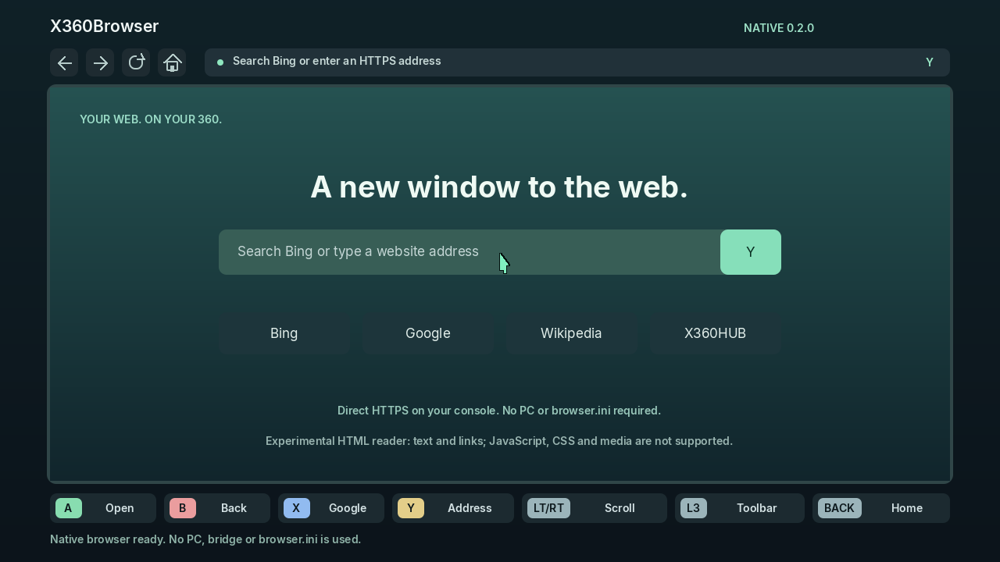

# X360Browser

Experimental native HTML reader for **Xbox 360 RGH/JTAG**, with an Edge-inspired interface, direct HTTPS and a gamepad-controlled mouse pointer. UI and documentation are in English.

**Version 0.2.0 runs on the console without a PC.** Copy `default.xex` to the Xbox and launch it. No browser.ini, Python, bridge, desktop browser or Windows Firewall setup is used.



## Compatibility

This is X360Browser with an Edge-inspired design, **not Microsoft's Edge binary or the Chromium engine**. The initial native engine displays HTML text and clickable links. It does not implement CSS layout, JavaScript, images, video, audio, cookies, login, interactive forms or downloads. Modern websites and search providers may require JavaScript or return verification pages. Bing/Google queries are sent directly to the providers; usable search results are not guaranteed.

Changing the interface or search provider does not add a modern browser engine. A full NetSurf/Chromium-class engine is not integrated in this preview.

## Install

1. Download default.xex from the [native preview release](https://github.com/heltindev/X360Browser/releases/tag/v0.2.0-native-preview).
2. Copy it to a folder on the Xbox HDD/USB, such as `Hdd1:\APLICATIVOS\X360Browser\default.xex`.
3. Launch through Aurora. Existing browser.ini files are ignored.
4. Connect the console to the Internet and set its date/time correctly for HTTPS.
5. Press Y for an HTTPS address or Bing query; X starts a Google query.

## Controls

| Control | Action |
|---|---|
| Left stick / D-pad | Move mouse pointer |
| A | Click link, home shortcut or toolbar |
| B / LB | Back |
| RB | Forward |
| LT / RT, or right stick | Scroll |
| Y | Address / Bing keyboard |
| X | Google search keyboard |
| L3 | Focus toolbar; use D-pad left/right and A |
| START / R3 | Reload |
| BACK | Home |
| Guide | Use the console menu to return to dashboard |

The pointer changes color over links. Physical USB mouse support is **not implemented or verified**; use the Xbox gamepad.

## Build

Open X360Browser.vcxproj in Visual Studio 2010 with a locally installed Xbox 360 SDK, choose **Release | Xbox 360**, or run build-release.cmd. Output: Release/default.xex. SDK files are not included.

BearSSL performs TLS 1.2, certificate-chain, hostname and validity checks using a vendored public CA bundle. Verification is not disabled. Only HTTPS is fetched; HTTP addresses are upgraded to HTTPS and require destination support. Page sizes and document structures are bounded. Networking, parsing and rendering run inside the XEX.

## Verification

Native tests exercise URL/search handling, entity decoding, removal of script/style text, links, pointer hit testing and the same UI renderer as the XEX. A Windows adapter tests the same BearSSL/HTTP code; it does not verify Xbox networking or hardware. See docs/native-verification.txt and docs/build-verification.json for observed results.

```powershell
powershell -NoProfile -ExecutionPolicy Bypass -File tests/build-native-host.ps1
.\obj\NativeHost.exe --network
```

**Physical Xbox testing remains pending.** Report the address, on-screen step/TCP/TLS/HTTP error, and a photo if needed.

## Sources and license

Orbita legacy 0.21.44 supplies the CPU drawing/text modules. The user-owned X360HUB TLS transport supplies the adapted native socket/BearSSL layer. HTML reader, browser layout, navigation and gamepad mouse are new.

GPL-3.0; see LICENSE and THIRD_PARTY.md. Independent project; not affiliated with Microsoft. Xbox and Microsoft Edge are Microsoft trademarks.
