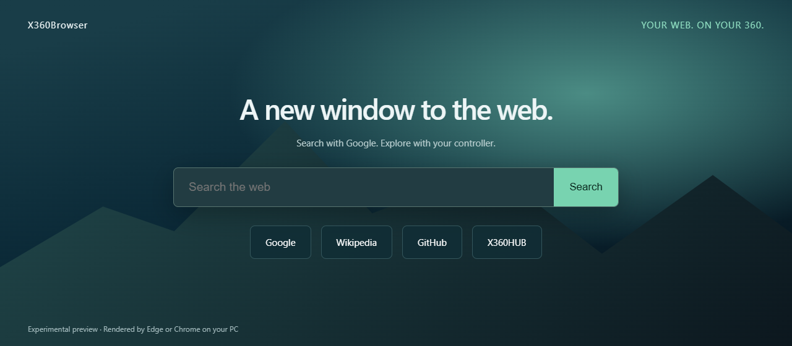

# X360Browser

An experimental, controller-driven web browser client for **Xbox 360 RGH/JTAG**, with an Edge-inspired interface and Google search. All interface text and project documentation are in English.

**Version 0.1.0 is a PC-assisted preview.** Edge or Chrome renders websites on a Windows PC; a native Xbox 360 XEX displays page frames and sends controller actions over the local network. The PC must stay on. This is not a native port of Chromium, Microsoft Edge, or Google Chrome to PowerPC.



## Quick start

1. On the PC, install Python 3.11 or later and either Microsoft Edge or Google Chrome.
2. In the project directory, run `python -m pip install -r bridge/requirements.txt`.
3. Run `python scripts/configure.py`. This generates `Release/browser.ini` with your PC address and a random bridge token. Keep this file private.
4. Start **one** service: `start-edge.cmd` or `start-chrome.cmd`. Both use port 36080. The browser opens in an isolated, temporary profile.
5. Copy `Release/default.xex` **and your generated** `Release/browser.ini` to the same folder on your Xbox USB/HDD. Launch `default.xex` through Aurora or another homebrew launcher.
6. Keep the PC and console on the same trusted home network. Wired Ethernet is recommended. If Windows Firewall blocks it, allow the Python bridge on the private network only, TCP port 36080.

If using a release ZIP, extract it first and follow the included `TESTING.md`. A release archive has no private token: run the configuration script before copying files to the console.

## Controls

| Control | Action |
|---|---|
| Left stick / D-pad | Move the on-page pointer |
| A | Click |
| B / LB | Back |
| RB | Forward |
| Y | Open address/search keyboard |
| X | Type into the page's focused field |
| START | Send Enter to the page |
| LT / RT | Scroll up / down |
| BACK | New-tab home page |
| Right stick click | Reload |
| Xbox Guide | Return to the dashboard using the console menu |

To search: press Y, type a query, and confirm the console keyboard. To use a form: point at its field, press A, then X to type; press START to submit.

## Build

Open `X360Browser.vcxproj` in Visual Studio 2010 with the Xbox 360 platform installed, select **Release | Xbox 360**, and build. Or run `build-release.cmd`. The output is `Release/default.xex`. The build script expects your locally installed Xbox 360 SDK at `C:\Program Files (x86)\Microsoft Xbox 360 SDK`. SDK headers, libraries, tools and installation files are not included in this repository.

## What is included

- Native XEX launcher, 1280×720 interface and controller input.
- Address/search keyboard, mouse clicks, text input, scrolling and browser history.
- Edge and Chrome renderer selection using Playwright's documented `msedge` and `chrome` channels ([upstream documentation](https://playwright.dev/python/docs/browsers)).
- Authenticated LAN protocol with validated frame sizes and bounded network waits.
- Orbita-derived CPU UI primitives and rasterized Inter typography.

## Limitations and verification

This preview sends raw 1280×560 ARGB page snapshots rather than a video stream. Expect a low page refresh rate and higher bandwidth than compressed streaming. It is designed for text browsing and initial controller tests. There is no audio, video playback support, persistent login/profile, bookmarks, download manager, multi-tab interface, or native HTML/JavaScript engine on the Xbox. Websites can show cookie prompts, CAPTCHA or automation restrictions.

The bridge uses token-authenticated **unencrypted HTTP on your LAN**. Do not expose port 36080 to the Internet. Personal Edge/Chrome profiles are not used.

PC tests cover Edge and Chrome, actual text and pointer input, scrolling, HTTPS navigation, browser history, frame dimensions and byte order, and unauthorized requests. Google presented a CAPTCHA in both browsers during testing; search results were not verified. See `docs/browser-test-results.json` for observed results. **A successful build is not a physical-console test. Xbox hardware behavior remains to be tested by the user.**

```text
python -m unittest discover -s tests
python tests/smoke_browsers.py
```

## Source and licensing

Based on the user-supplied `orbita-main` legacy 0.21.44 source. Only the reusable XUI drawing/text modules are derived from Orbita; cloud login, subscriptions, beta gates, telemetry and update services are not used. The original client targeted libxenon/XeLL ELF. This client has a new XDK/D3D9 XEX platform layer.

GPL-3.0; see [LICENSE](LICENSE) and [THIRD_PARTY.md](THIRD_PARTY.md). Xbox and Microsoft Edge are Microsoft trademarks. Chrome and Google are Google trademarks. This is an independent project.
