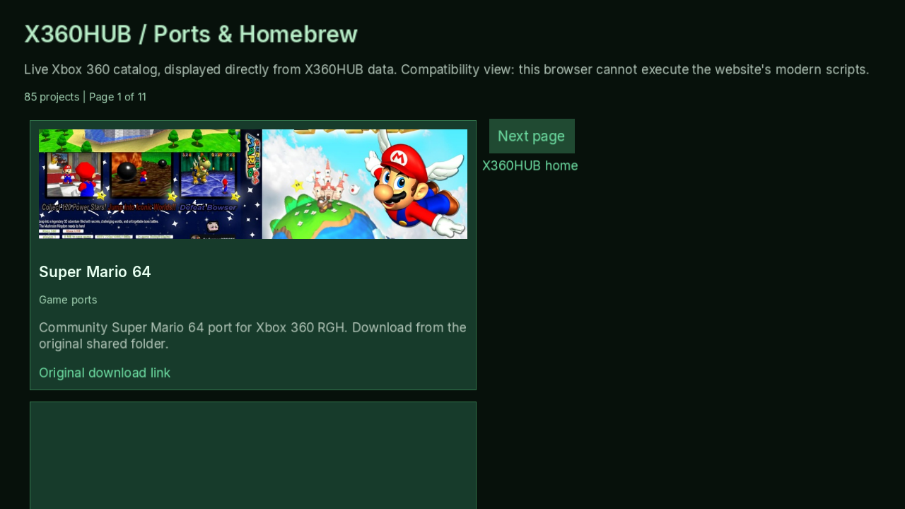
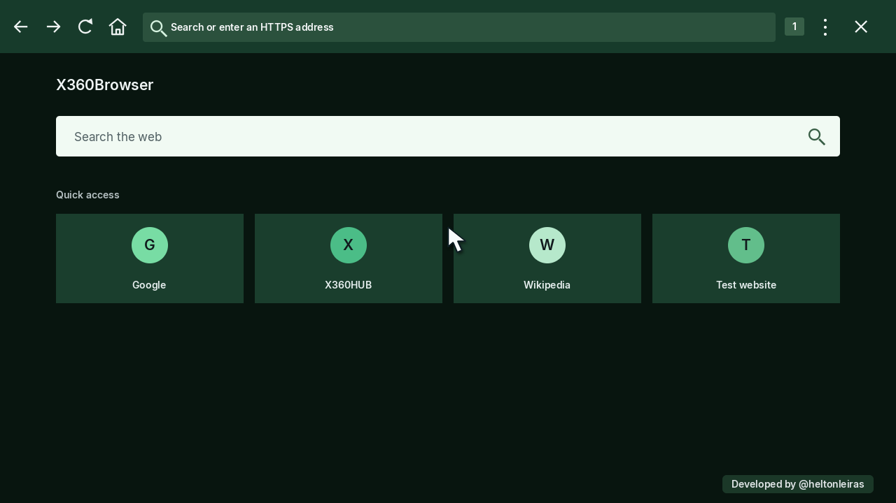
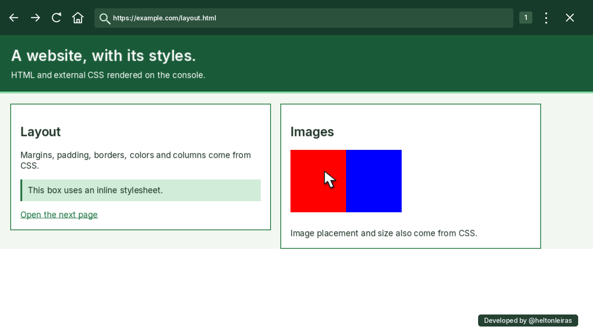

# X360Browser

**Google Search status: NOT WORKING in the native XEX.** A standalone PowerPC QuickJS port probe failed under XDK 2010 (C and C++ attempts). Google still serves a JavaScript-required response with no actual results. See [the tested QuickJS/XDK blockers](docs/QUICKJS_XDK_PORT_DIAGNOSTIC.md) and run `python tools/verify_google_results.py` to reproduce the strict Google-only test. The Bing alternative is separately labeled and is not a fix for Google.

## 0.10.0-dom-foundation-preview - 2026-11-01

**The real Google Search results are still NOT working on Xbox.** This release is an incremental native DOM foundation, not a Chrome/Edge port. Google returned ~93 KB of JavaScript-required HTML without result links. A Lynx User-Agent returned a ~2.4 KB "upgrade browser" screen, also without results. No User-Agent trick has been shown to yield real Google results. The 0.9.2 opt-in Bing fallback is retained as a distinct provider; it is not Google.

The XEX's bounded Duktape bridge now supports basic DOM **document.createElement**, safe attributes and text, building nested detached nodes, **appendChild**, **insertAdjacentHTML('beforeend')** and **DOMContentLoaded** / window load callbacks before layout. The Windows-host fixture dynamically constructs an article and footer, triggers both events and paints them via litehtml; PowerPC XEX builds with the same source. This is **not** a complete persistent DOM and does not execute modern ES2022 modules, fetch, browser events, Google Search or MP4. Physical Xbox 360 testing is pending.

See [Google native-engine feasibility and acceptance tests](docs/GOOGLE_NATIVE_ENGINE.md) and [dynamic DOM host render screenshot](docs/dom-ready-native-render-host.png).


## 0.9.2-search-results-visibility-preview - Google white-screen diagnosis (2026-11-01)

**The Google query white-screen is reproduced and explained.** Live requests to https://www.google.com/search?q=Xbox%20360 returned HTTP 200 with ~93 KB but ONLY a JavaScript-required error/interstitial, not the actual results. The response included a no-script stylesheet that hides all divs/p paragraphs in litehtml. Google still needs a modern browser engine/DOM to show its true search results. We do not bypass or misrepresent that requirement.

X360Browser now detects the REAL Google's JS-required response and replaces the invisible interstitial with a visible explicit notice, retaining the original search query and a Retry Google link. It ALSO offers a clearly labeled **opt-in Bing alternative** to get usable search results on this console; Bing receives the query only AFTER the user selects that link. The Xbox downloads Bing's actual public RSS search feed via direct HTTPS, parses it on-console and renders clickable titles, descriptions and source URLs using litehtml. **Bing results are never labeled Google results.** If Bing's feed is invalid, a visible error is shown instead of an empty screen.

The live Windows-host regression test confirmed Google JS-required page detection, explicit link hit testing (mouse/pointer click) and **10 Bing search results / 11 links** loaded and rendered. The native XDK release XEX builds. Actual physical Xbox 360 test has NOT been performed for 0.9.2. This does not make arbitrary JavaScript-heavy pages, Google sign-in/autocomplete, YouTube, or MP4 work.

[Google JS-required notice screenshot (actual host rendering)](docs/google-js-required-notice-host.png) and [live Bing results screenshot (actual host rendering)](docs/bing-live-search-host.png).


## 0.9.1-google-live-home-preview - Google homepage (2026-11-01)

**The Google homepage is fetched live** through console-native HTTPS from https://www.google.com/ and rendered from Google's actual HTML, inline CSS, image and links (not a screenshot or locally mocked homepage). The renderer lacked CSS behavior for the legacy HTML center tag: a tiny Google-only compatibility stylesheet now centers the real downloaded Google logo. Because litehtml does not implement functional HTML input fields, the search box and button are native Xbox controls drawn over the actual page and are clickable with the gamepad pointer. Activating either opens the console's on-screen keyboard and sends an escaped query to Google's real search URL. Google search treats dotted terms such as x360hub.com as search text rather than a direct address. The field/button remains aligned when the webOS-inspired top toolbar automatically hides.

[Windows-host preview showing the actual fetched Google homepage](docs/google-homepage-with-toolbar-host.png).

Windows-host tests: HTTPS page returns HTTP 200 with around 88 KB of real HTML, CSS 1 loaded, 0 failed, Google-provided wordmark image 1 loaded, native search hitbox verified with toolbar both shown and hidden. The Xbox 360 PowerPC XEX compiles using the SDK. Physical-console testing remains **unverified**; full modern Google Search results DOM, login, autocomplete, modern JS frameworks, YouTube and MP4 remain unsupported or incomplete. An interactive native textbox does not mean a complete implementation of the Google website.


## 0.9.0-live-catalog-preview - 2026-11-01

Physical-console warning: this is **not** an Edge/Chrome-equivalent web browser. The legacy litehtml + Duktape architecture cannot render arbitrary modern JavaScript single-page applications or play MP4/H.264. This revision provides a dedicated **live catalog compatibility view** for the JS-generated X360HUB ports.html page. It fetches the public https://x360hub.vercel.app/data/catalog.json directly on the console through HTTPS. No PC proxy, screenshot relay, or mocked data. It displays eight published entries per page, descriptions, horizontal cover URLs, and original download/repository links.

The Xbox SDK Release XEX and Windows host compiled. The real Windows-host network test retrieved 85 current catalog records, rendered HTML and CSS, and loaded a live project cover. The console still needs a physical hardware test. Other sites use the existing limited litehtml/Duktape engine and JavaScript-heavy content may still be incomplete.

**Console test:** open the native X360Browser home, select X360HUB, then Explore catalog. The compatibility page should show the live project's titles and covers with Next/Previous links, using native network access.




## 0.8.0-js-layout-preview changes

Duktape 2.7.0 now compiles inside the native Xbox PowerPC XEX. It executes bounded ES5-compatible inline scripts and up to three same-origin external scripts. The limited DOM bridge supports document.write, document.getElementById(id).innerHTML/textContent setters and querySelector('#id'). The JavaScript engine uses a 6 MiB heap limit and a 300 ms bytecode execution limit, both tested on the Windows host. It is NOT a full DOM/event/browser API environment, modern ES module loader, or Chrome-compatible runtime.

Horizontal Flexbox and simple grid-template-columns:repeat(2-4,1fr) styles now receive float-based layout fallbacks tested by pixel comparisons. Those are NOT complete CSS Flexbox or Grid layouts.

The Windows host fetched X360HUB HTML and one stylesheet successfully, but both external X360HUB JavaScript files still fail syntax parsing in Duktape. This console-native browser cannot yet render all features of modern JS websites. MP4/H264/YouTube/streaming remains unimplemented; the experimental native WMV/XMV player is unchanged. The 0.8 XEX has NOT yet been tested on physical Xbox hardware.


This revision includes zlib 1.3.1 gzip/deflate HTTP decoding, an HTTP Accept header suitable for CSS/image requests, 5.5-second per-resource inactivity timeout, and limited constant :root CSS variable substitution for visual compatibility. It reduces repeated Google Fonts requests that this renderer cannot use. No full modern DOM/JavaScript, Flexbox/Grid or MP4 browser engine is claimed.

The native home screen opens first (Google, X360HUB, Wikipedia and connection-test shortcuts). Search queries always go to Google; the small tab number at the top-right opens the tab picker. Create or switch among up to four tabs, each retaining its page, history and scrolling. The page fills the screen when the toolbar automatically hides. During navigation, an animated spinner appears over a dark overlay. The preview watermark is painted over the webpage.

HTML and external/inline CSS are rendered before images, which load progressively. A 6 MiB RAM-only response cache speeds up revisits within 180 seconds; it is wiped when the application exits, and explicitly private/no-store/no-cache responses are not stored. CSS supports common CSS content types. This legacy litehtml engine still lacks complete modern CSS and JavaScript-driven interactivity.

The dim bottom-left statistics display the physical RAM usage reported by the Xbox SDK, as MB and percentage of reported physical memory. The RAM indicator uses GlobalMemoryStatus to show SDK-reported physical memory used/available in MB and percent, not response cache size. CPU utilisation and frame-time metrics are hidden. CPU/GPU temperatures are queried read-only from the console SMC and displayed only when within a plausible range. This sensor path is not yet tested on physical hardware. This is system-wide physical RAM pressure, not just memory used by the browser. No PC helper, browser.ini or PowerPC simulator is required: the XEX is compiled natively for the console. The older builds had owner-reported physical-console failures. The 0.8 build passed SDK and Windows host tests; physical-console compatibility remains unverified.


Experimental native browser for Xbox 360 RGH/JTAG. **No PC, browser.ini or relay is required.** Version 0.8.0-js-layout-preview adds full-screen pages, four switchable tabs, a dark loading animation, progressive images, a bounded RAM cache and Google as the default search provider, with a native shortcut home screen. All UI text is in English.



## Install

For the 0.8.0-js-layout-preview build use the local Release/default.xex on the build PC, copy it to USB/HDD and launch through Aurora. The existing linked 0.4.0 preview release does not contain this version. Keep the console connected to the Internet and its date/time correct for HTTPS certificates. Old INI files are ignored.

## Interface and controls

The green top bar, green focus outlines, recommended-site tiles and right-side menu are inspired by the supplied LG browser references. No LG branding/assets are used. The toolbar and pointer disappear after **4.5 seconds without input**; moving the stick or pressing a button reveals them. Open menus and the keyboard keep controls visible.

- Left stick / D-pad: mouse pointer. A: click.
- LT/RT or right stick: scroll. B/LB: back. RB: forward.
- Y/X: address or Google query. START/R3: reload (bypasses the current page cache entry). BACK/Home: native shortcuts page.
- L3: open/close the menu. D-pad up/down and A select an item; B closes it.
- During video: A pauses/resumes, B stops.

The cursor is an original anti-aliased image icon with hover coloring. It uses the gamepad; physical USB mouse input is not implemented.

## Images and video

| Content | Current implementation |
|---|---|
| HTML and supported CSS | Native litehtml layout; external/inline styles, simple responsive-width media rules, constant :root CSS variables, boxes and links; simple float-based horizontal Flex/Grid compatibility, not full standards-conformant layout |
| JPEG, PNG, BMP | Downloaded directly and decoded with stb_image |
| GIF | First frame only |
| Page images | Up to eight HTTPS img resources; includes basic data-src lazy-image URLs |
| Direct image address | Native image view |
| Direct WMV/XMV video | Buffered in RAM and handed to native XMedia2 with XAudio2 audio; codec/hardware verification pending |
| HTML video/source tags | Clickable video cards for direct URLs |
| MP4/H.264, HLS/DASH, DRM, YouTube players | Not implemented |
| JavaScript ES5 | Bounded Duktape integration with partial document.write/getElementById and same-origin external script support. Not full DOM. |
| Modern JS, full Flexbox/Grid, cookies/login, interactive forms | Not implemented |
| SVG, WebP, CSS background images, animated GIF | Not implemented |

Limits: 2 MB per image, 4096 pixels per dimension and 4 million decoded pixels; images are scaled to fit. Video buffering is capped at 64 MB and completes before playback. Unsupported codecs/content show an error instead of a success message. The renderer is a VS2010-compatible port of legacy litehtml v0.3. It renders supported static HTML/CSS, not the complete modern web platform. Flexbox/Grid, JavaScript-driven pages, web fonts and advanced CSS can still render incompletely. Video format limits are unchanged.

## Preview watermark

**Developed by @heltonleiras** remains visible on pages and the video overlay, even when the toolbar is hidden. It is enabled by X360BROWSER_PRERELEASE=1 in src/lg_ui.h. A stable release can build with that definition set to 0; this release remains a preview.

## Build and verification

Visual Studio 2010 + locally installed Xbox 360 SDK: open X360Browser.vcxproj with Release | Xbox 360 or run build-release.cmd. Output: Release/default.xex. Proprietary SDK source/tools are not shipped.

Host tests exercise PNG/JPEG/GIF/BMP decoding, rejected malformed data, image/video HTML parsing, layout, pointer/menu hit tests, toolbar inactivity and watermark persistence. The same UI code produces docs screenshots. Network tests use the same HTTPS transport through a Windows adapter. **Physical Xbox testing, video/audio decoding and playback are still pending**; host tests do not prove console compatibility.

```powershell
powershell -NoProfile -ExecutionPolicy Bypass -File tests/build-native-host.ps1
.\obj\NativeHost.exe --network
```

A native image test page is available at https://raw.githubusercontent.com/heltindev/X360Browser/main/tests/fixtures/media.html . It contains original red/blue PNG, JPEG, GIF and BMP fixtures.

GPL-3.0. See LICENSE, THIRD_PARTY.md and docs/build-verification.json. Independent project, not affiliated with LG or Microsoft.

## CSS verification and source review



The fixture at tests/fixtures/layout.html uses an external stylesheet, inline styles, two columns, linked images and clickable DOM links. The same native rendering code is used by the Xbox binary and host checks. CSS resources are limited to ten unique stylesheets, 512 KB per stylesheet and 1.5 MB total; styled HTML is capped at 1 MB, with a reader fallback above that. Images use a bounded native cache.

Both supplied files were reviewed in full: [video/GPU review](docs/UPLOADED-CODE-REVIEW.md). They inform video/graphics work, not CSS parsing. This release does not claim new H.264 playback.
